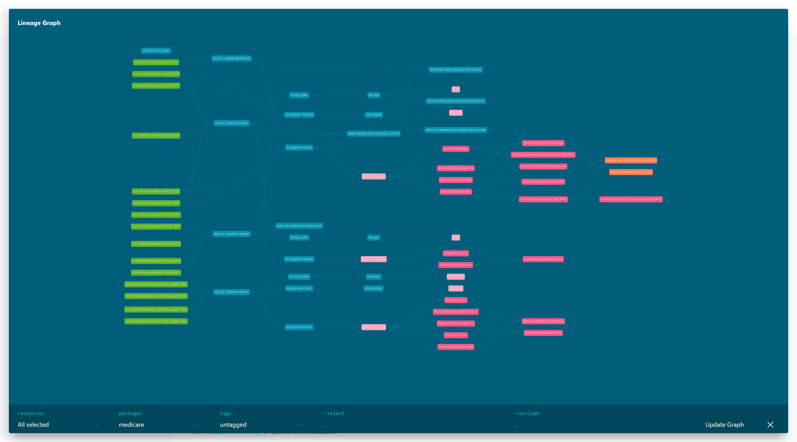

# Medicare charges and payments: a dbt + BigQuery + MetricFlow sample

A working dbt Core project on BigQuery that turns CMS Medicare public use files
into tested, documented marts and a MetricFlow semantic layer. It runs against
`bigquery-public-data.cms_medicare`, so anyone with a GCP project can clone it
and reproduce every number here.

Two smaller add-on modules sit beside it: **thelook e-commerce** (the order
vs order-item grain trap) and **NYC taxi** (partitioning and cost on an
unpartitioned 7.5 GB source). All three share one dbt project and one
semantic layer: 30 models, 191 tests, 14 semantic models, 47 metrics.

It is a portfolio sample by Scott Fiene (Corvyn Systems). It shows the way I
build client projects: layered models, grain written down for every table,
tests aimed at the real traps in the data, and metrics defined once in the
semantic layer instead of re-derived in each dashboard.

## The problem

CMS publishes what hospitals and physicians billed Medicare and what Medicare
paid, one table per year. The files look clean. They are not:

- Hospital IDs lose their leading zero, so joins silently drop whole states.
- Zip codes arrive as strings, as float strings (`99519.0`), and as integers,
  depending on the year.
- Every amount is an **average per row**. Sum or average those directly and
  the answer is wrong.
- The 2011-2013 inpatient files cover the top 100 DRGs; 2014-2015 cover about
  560. A naive trend line shows a jump that is scope, not volume.
- Missing star ratings are the string `'Not Available'`, and the easy fix
  (`0`) is the wrong one.

The project answers questions like "what does Medicare pay per discharge, by
state and hospital type, and how has that moved" in a way that holds up when a
client checks the math.

## Layer design

```
sources (bigquery-public-data.cms_medicare, 15 tables)
  -> staging       views. Union the yearly files, rename, cast, fix keys. 1:1 with source grain.
  -> intermediate  tables. Shared logic: entity resolution, code dimensions, latest attributes.
  -> marts/core    tables. Facts and dimensions, partitioned and clustered.
  -> marts/semantic MetricFlow semantic models, metrics, saved queries, time spine.
```

| Layer | Model | Grain | Business key |
|---|---|---|---|
| staging | `stg_cms__inpatient_charges` | hospital x DRG x year | provider_id, drg_code, service_year |
| staging | `stg_cms__outpatient_charges` | hospital x APC x year | provider_id, apc_code, service_year |
| staging | `stg_cms__hospital_general_info` | hospital | provider_id |
| staging | `stg_cms__physician_services` | NPI x HCPCS x place of service x year | npi, hcpcs_code, place_of_service, service_year |
| intermediate | `int_hospitals__resolved` | hospital (any source) | provider_id |
| intermediate | `int_drg_codes` | DRG code | drg_code |
| intermediate | `int_apc_codes` | APC code | apc_code |
| intermediate | `int_physicians__latest` | NPI | npi |
| intermediate | `int_hcpcs_codes` | HCPCS code | hcpcs_code |
| mart | `dim_hospital`, `dim_drg`, `dim_apc`, `dim_physician`, `dim_hcpcs` | as above | as above |
| mart | `fct_inpatient_charges` | hospital x DRG x year | provider_id, drg_code, service_year |
| mart | `fct_outpatient_charges` | hospital x APC x year | provider_id, apc_code, service_year |
| mart | `fct_physician_services` | NPI x HCPCS x place x year | npi, hcpcs_code, place_of_service, service_year |

### Grain decisions

- **Facts store totals, not averages.** CMS gives `average_medicare_payments`
  per row. The fact multiplies by `total_discharges` to get
  `total_medicare_payments`, which is additive across any dimension. Every
  "per discharge" or "per service" number is a ratio of sums in the semantic
  layer. The source averages stay on the row for reading, documented as
  "never aggregate".
- **Code dimensions key on the code, not the label.** CMS rewords DRG and APC
  descriptions between years. Keying on the 3-digit DRG code and keeping the
  latest label keeps one row per DRG. The as-reported label stays on the fact.
- **Dimensions take the latest attributes.** About 700 hospitals change name
  across the five years. `dim_hospital` uses Hospital Compare's curated name
  when it exists and the most recent billing-file name otherwise, chosen with
  a deterministic `qualify row_number()`.
- **`dim_hospital` is a full outer join.** About 7% of billing hospitals are
  missing from Hospital Compare, and some listed hospitals never bill. Both
  are kept, with `has_general_info` and `has_charge_data` flags, so the
  relationships tests from the facts always have a parent.
- **`beneficiary_count` is not a measure.** It is a distinct count per NPI x
  HCPCS row. Summing it across codes counts one patient many times, so it is
  documented on the fact and left out of the semantic layer on purpose.

## Traps found in the data, and the test that catches each one

Every trap below was found by profiling the source, not assumed.

| Trap | What it does if missed | Fix | Test |
|---|---|---|---|
| CCN loses its leading zero in charge files (`70029` vs `070029`) | Raw join matches 73-77% of hospitals per year; every hospital in states 01-09 (AL-CT) drops out | `clean_ccn()` macro pads to 6; padded match is 88.9% (2011) to 93.4% (2015), lower in early years because Hospital Compare is a current snapshot and closed hospitals are gone | `assert_ccn_padding_keeps_hospital_join_coverage` (fails under 85%) and `matches_regex` on `provider_id` |
| Zip stored as float string in 2013 inpatient, INT64 in 2015 outpatient | `select *` union fails, or New England zips become `2134` | Explicit column lists with casts, `clean_zip5()` macro | `assert_zip_codes_keep_leading_zeros`, `matches_regex '[0-9]{5}'` |
| Amounts are per-row averages | Averaging averages weighs a 12-discharge hospital like a 900-discharge one: 2015 Medicare payment per discharge comes out $11,213.91 instead of $10,517.57 (6.6% high) | Facts store discharge-weighted totals; metrics are ratios of sums | `assert_inpatient_totals_reconcile_to_source` (mart vs raw, to the cent) |
| DRG labels reworded across years (3 codes) | Grouping on the label splits one DRG into two; joins fan out and double dollars | Key on `drg_code` | `unique` on `dim_drg.drg_code`, `assert_inpatient_grain_survives_dimension_joins` |
| 2011-2013 cover the top 100 DRGs, 2014+ about 560 | Discharges "grow" 12.0% from 2013 to 2014; on DRGs present every year they fell 4.6% | `dim_drg.is_in_all_years`; trend-safe metrics filter on it | `comparable_*` metrics in the semantic layer |
| `'Not Available'` for 2,006 of 5,336 star ratings (38%) | Coalesced to 0, the average rating drops from 3.24 to 2.03 stars and unrated hospitals rank last | `not_available_to_int()` makes them NULL | `assert_star_rating_missing_is_null_not_zero`, `accepted_values [1-5]`, `null_proportion_at_most 0.45` |
| Gender blank for organizations (about 4.5% of physician rows) | Looks like bad data; or someone fills it with `'U'` | NULL for organizations by design | `null_proportion_at_most 0.01` scoped to individuals only |
| CMS suppresses rows under 11 discharges/services | Files look complete but are not; missing means "under 11", not 0 | No zero-fill anywhere | `expression_is_true: total_discharges >= 11` |
| Schema drift: physician files drop `stdev_*` in 2014 | `select *` union breaks | Union on common columns only | Build fails loudly if a column disappears |

The custom generic tests (`unique_combination_of_columns`, `expression_is_true`,
`matches_regex`, `null_proportion_at_most`) live in `tests/generic/`. The
project has no package dependencies.

## Semantic layer (MetricFlow)

`models/marts/semantic/` defines:

- **8 semantic models**: three facts (`inpatient_charges`,
  `outpatient_charges`, `physician_services`) and five dimensions
  (`hospitals`, `drgs`, `apcs`, `physicians`, `hcpcs_codes`), joined through
  the entities `hospital`, `drg`, `apc`, `physician` and `hcpcs`.
- **Measures** that are all additive (`sum` of totals, or `count_distinct`).
- **20 metrics**: simple, ratio (`medicare_payment_per_discharge`,
  `inpatient_payment_to_charge_ratio`), filtered (`comparable_inpatient_discharges`
  uses `drg__is_in_all_years`), and derived with an offset window
  (`comparable_discharges_yoy_growth`).
- **2 saved queries** a dashboard could sit on.
- A `metricflow_time_spine` model built with `GENERATE_DATE_ARRAY`.

Example queries:

```bash
mf query --metrics comparable_medicare_payment_per_discharge --group-by metric_time__year,hospital__state --order -metric_time__year --limit 10
```

```bash
mf query --metrics medicare_payment_per_discharge,inpatient_payment_to_charge_ratio --group-by hospital__hospital_type --where "{{ TimeDimension('metric_time', 'year') }} = '2015-01-01'"
```

Validation, including checks against the warehouse:

```
$ mf validate-configs
🎉 Successfully validated the semantics of built manifest (ERRORS: 0, FUTURE_ERRORS: 0, WARNINGS: 0)
🎉 Successfully validated semantic models against data warehouse (ERRORS: 0, FUTURE_ERRORS: 0, WARNINGS: 0)
🎉 Successfully validated dimensions against data warehouse (ERRORS: 0, FUTURE_ERRORS: 0, WARNINGS: 0)
🎉 Successfully validated entities against data warehouse (ERRORS: 0, FUTURE_ERRORS: 0, WARNINGS: 0)
🎉 Successfully validated measures against data warehouse (ERRORS: 0, FUTURE_ERRORS: 0, WARNINGS: 0)
🎉 Successfully validated metrics against data warehouse (ERRORS: 0, FUTURE_ERRORS: 0, WARNINGS: 0)
```

Why the trend-safe metrics exist, straight from the semantic layer:

```
$ mf query --metrics inpatient_discharges,comparable_inpatient_discharges,comparable_discharges_yoy_growth,comparable_medicare_payment_per_discharge --group-by metric_time__year
metric_time__year  inpatient_discharges  comparable_inpatient_discharges  comparable_discharges_yoy_growth  comparable_medicare_payment_per_discharge
2011-01-01                      6975318                          6835187                                                                      8356.40
2012-01-01                      6662965                          6543807                           -0.0426                                    8602.45
2013-01-01                      6517112                          6410987                           -0.0203                                    8699.01
2014-01-01                      7297885                          6113453                           -0.0464                                    9044.82
2015-01-01                      7433268                          6226694                            0.0185                                    9036.18
```

The unfiltered series says discharges rose 12% in 2014. They fell 4.6%. The
difference is CMS publishing more DRGs, not more patients.

The NULL hospital type below is real information, not a bug: those 136,943
discharges come from hospitals that bill Medicare but are missing from
Hospital Compare. The full outer join in `dim_hospital` keeps them visible
instead of dropping them.

```
$ mf query --metrics medicare_payment_per_discharge,inpatient_payment_to_charge_ratio,inpatient_discharges --group-by hospital__hospital_type --where "{{ TimeDimension('metric_time', 'year') }} = '2015-01-01'"
hospital__hospital_type  medicare_payment_per_discharge  inpatient_payment_to_charge_ratio  inpatient_discharges
Acute Care Hospitals                           10535.90                              0.245               7296325
(null)                                          9541.11                              0.213                136943
```

## Cost control

The raw sources total about 10 GB, nearly all of it the four physician files
(about 2.4 GB each). Four things keep the project cheap:

1. **Partitioned and clustered facts.** All three facts are integer-range
   partitioned on `service_year`. `fct_physician_services` (37M rows) is
   clustered on `provider_state, hcpcs_code, provider_type`; the hospital
   facts on `provider_state` plus the DRG or APC code.
2. **A slim large fact.** The HCPCS description and drug flag live in
   `dim_hcpcs`, and the surrogate key is an INT64 `FARM_FINGERPRINT` instead
   of a 35-byte string. That took `fct_physician_services` from 7.05 GB to
   4.04 GB, which is what lets a full rebuild run inside the free BigQuery
   sandbox (10 GB storage cap).
3. **A hard ceiling.** `maximum_bytes_billed: 10000000000` in the profile
   makes any single query over 10 GB fail instead of run.
4. **Staging as views, column-pruned.** Staging selects named columns only,
   so BigQuery's columnar storage reads a fraction of each source table.

Measured on the built marts (query cache off):

| Query | Bytes processed |
|---|---|
| Raw source, 2015 file, Indiana, CPT 99213 | 256.4 MB |
| `fct_physician_services`, all four years, no filter | 298.0 MB |
| same, `where service_year = 2015` (partition pruning) | 152.0 MB |
| same, plus `provider_state = 'IN' and hcpcs_code = '99213'` (cluster pruning) | **11.3 MB** |

The raw query and the pruned mart query return the same answer, $114,491,985
in Medicare payments, at 1/23 of the bytes.

The Medicare module's build (18 models, 117 tests) processes about 12.8 GB: roughly
$0.08 at on-demand pricing, and inside the 1 TB monthly free tier. Over 90%
of the bytes billed are the tests on the 37M-row fact; the models themselves
are cheap. The taxi module adds about 7 GB, the one read of its unpartitioned
source.

## Add-on module 1: thelook e-commerce (order vs order-item grain)

`models/ecommerce/` builds on `bigquery-public-data.thelook_ecommerce`, a
synthetic clothing store that Google regenerates every day.

| Model | Grain | Business key |
|---|---|---|
| `stg_thelook__orders`, `__order_items`, `__products`, `__customers` | 1:1 with source | source id |
| `fct_order_items` | order item | order_item_id |
| `fct_orders` | order | order_id |
| `dim_products`, `dim_customers` | product, customer | product_id, customer_id |

| Trap | What it does if missed | Fix | Test |
|---|---|---|---|
| `orders.num_of_item` is order-level | Join orders to items and sum it: 181,049 items become 343,623 (1.9x) | Order totals are rolled up from `fct_order_items`, never joined down | `assert_order_revenue_does_not_fan_out`, `expression_is_true: item_count = reported_item_count` |
| The generator writes rows up to 3 days in the future (1,399 items) | "Revenue today" counts sales that have not happened | Flag in staging, drop at the order level so an order never loses some of its items | `assert_no_future_dated_orders_in_marts` |
| Item `created_at` is not the order time (differs on 181,047 of 181,049 items), and 19% of items "ship" before their own `created_at` | Negative fulfillment times | Every item is anchored to its order's timestamp | `expression_is_true: days_to_ship >= 0` |
| Unshipped orders | Filling `days_to_ship` with 0 makes fulfillment look instant | NULL until shipped; `average_days_to_ship` divides by shipped orders only | metric definition |
| PII-shaped columns (name, email, street address) | Copied into every downstream table | Dropped in staging | not exposed anywhere downstream |

The data is live, so tests check relationships and invariants, never row
counts, and source freshness (`warn_after: 2 days`) is a real check here.
The tables are about 20 MB, so they are deliberately **not** partitioned:
partitions that small cost more in metadata than they save.

The semantic layer keeps order-grain and item-grain measures in separate
semantic models, so `average_order_value` (net revenue / orders, $64.48) and
`item_return_rate` (9.9%) can never be computed across a fan-out.

## Add-on module 2: NYC taxi (partitioning and cost)

`models/nyc_taxi/` builds on `new_york_taxi_trips.tlc_yellow_trips_2022`:
36.3M rows, 7.5 GB, and **not partitioned or clustered**. Every query
against it reads every byte of the columns it touches, whatever the filter.

| Model | Grain | Business key |
|---|---|---|
| `stg_tlc__yellow_trips` (ephemeral) | trip | trip_key |
| `fct_taxi_trips` | trip | trip_key |
| `fct_taxi_zone_daily` | pickup date x pickup zone | pickup_date, pickup_zone_id |
| `dim_taxi_zone` | TLC zone (265) | zone_id |

Design:

- **Staging is ephemeral, not a view.** A view over an unpartitioned 7.5 GB
  table would be re-scanned by every test and every downstream model.
  Inlined, the source is read once per build.
- **The trip fact is partitioned by day and clustered** by pickup zone and
  payment type, and built incrementally with `insert_overwrite`: each run
  replaces only the last `taxi_lookback_days` partitions. dbt runs a MERGE
  scoped to those partitions, so it never matches keys across the whole
  table.
- **The load window is a variable** (`taxi_start_date`, `taxi_end_date`),
  one month by default so it fits the free sandbox.
- **Dashboards read a rollup.** 2.5M trips become about 7k rows in
  `fct_taxi_zone_daily`, which the semantic layer sits on.

Measured, query cache off. The raw query and the pruned query return the same
answer, 3,205 trips and $145,993.48:

| Query: JFK pickups (zone 132) on 2022-01-15 | Bytes processed |
|---|---|
| Raw source | 1,045.3 MB |
| `fct_taxi_trips`, whole month, no filter | 39.4 MB |
| `fct_taxi_trips`, that day only (partition pruning) | 2.1 MB |
| `fct_taxi_trips`, that day and zone | **2.6 MB** (400x less than raw) |
| `fct_taxi_zone_daily`, that day and zone | 0.2 MB |

BigQuery bills a 10 MB minimum per query, so the last three bill the same. At
this size clustering adds nothing on top of the daily partition. It pays off
once the window is widened to a full year.

The incremental path, verified on a billed project. After a full build of
January 2022, a plain `dbt build --select fct_taxi_trips`:

| Check | Result |
|---|---|
| Partitions rewritten | Jan 28-31 only (the last `taxi_lookback_days` + 1); the other 27 untouched |
| MERGE row counts | 287,389 deleted, 287,389 inserted: exactly those four days |
| Table rows before and after | 2,463,900 and 2,463,900 |
| Bytes, MERGE into the target | 141 MB |
| Bytes, reading the source for the run | 7.5 GB |

That last row is the real lesson. Going incremental makes the writes cheap,
but the source is unpartitioned, so every run still pays for a full read of
the columns it touches. On a client project the fix is upstream: land the
raw data partitioned (or as monthly files), then the same model reads a few
days of it.

| Trap | What it does if missed | Fix | Test |
|---|---|---|---|
| The table is not partitioned | Filtering January 2022 still scans 7.5 GB | Ephemeral staging, partitioned fact, rollup | cost table above |
| The 2022 file holds pickups dated 2001-2023 | Stray years in every time series | Load window on `pickup_datetime` | `expression_is_true` on `pickup_date` |
| No trip id, and the obvious key (vendor, pickup, dropoff, zones) collides 11,369 times in January | `unique` on that key fails, or dedup deletes real trips | `FARM_FINGERPRINT` of the whole row (no exact duplicates exist) | `unique` on `trip_key` |
| `taxi_zone_geom` has 263 rows but only 260 ids (56 twice, 103 three times), and 5 ids trips use have no row | Joining trips to zones fans out; 29,795 trips (1.2%) match no zone | Merge polygons per id with `ST_UNION_AGG`; seed `taxi_zone_supplement` adds 57, 104, 105, 264, 265 | `unique` on `dim_taxi_zone.zone_id`, `relationships` from both zone columns |
| 134 trips claim over 100 miles (max 306,159) and hold 42% of all recorded miles | Average speed in the Bronx comes out at 206 mph | `has_plausible_distance` (<= 100 mi) and `has_plausible_speed` (<= 80 mph) | the Bronx reads 15.0 mph after; `assert_flagged_trips_stay_a_small_share` (1.85% flagged, fails past 10%) |
| TLC does not record cash tips (93 of 495,154 cash trips have one) | Tip rate over all fares: 18.6% | `taxi_card_tip_rate` = card tips / card fares: 24.0% | `assert_cash_trips_record_no_tips` (fails past 0.5%) |
| `passenger_count` NULL on 3.4% of trips (the payment_type 0 feed), 0 on another 2% | Average over all trips: 1.353 | `taxi_avg_passengers` divides by trips with a recorded count: 1.392 | `null_proportion_at_most 0.05` |
| Refunds and voids (228k negative totals in 2022), zero distance, dropoff before pickup | Inflated or negative revenue | Flagged, not deleted; the rollup uses `is_valid_trip` | `assert_zone_daily_reconciles_to_trips` |
| `rate_code` stored as float strings (`'99.0'`); `payment_type` 0 is undocumented | Join and filter misses | Parsed to INT64, 0 labelled "not recorded" | `accepted_values` |

## Running in the free BigQuery sandbox

Everything here runs in a project with no billing, with three caveats found
while building it:

1. **10 GB storage cap.** The physician fact was slimmed from 7.05 GB to
   4.04 GB so a rebuild fits. Total stored is about 5.2 GB.
2. **DATE partitions older than 60 days are deleted on write.** 2022 taxi
   partitions vanished the moment they were created, and the sandbox refuses
   a table-level override. With `DBT_BQ_SANDBOX=true`, the trip fact
   partitions on an INT64 day number (`pickup_unix_day`) instead, which the
   rule does not touch. Integer-range partitions are also why the Medicare
   facts were never affected.
3. **No DML.** `insert_overwrite` needs it, so in sandbox mode the trip fact
   builds as a plain table. On a billed project, leave `DBT_BQ_SANDBOX`
   unset to get DATE partitions and the incremental path.

Sandbox tables also expire after 60 days. Datasets created in the sandbox
keep those 60-day table and partition defaults even after billing is linked:
clear them on the datasets, then `dbt build --full-refresh`, or DATE
partitions older than 60 days are still deleted.

## How to run it

Requirements: Python 3.12, a GCP project with BigQuery enabled and billing on
(a full build fits in the free tier's 1 TB/month of query bytes).

```bash
python -m venv .venv && source .venv/Scripts/activate   # or .venv/bin/activate
pip install dbt-bigquery dbt-metricflow
gcloud auth application-default login
export DBT_GCP_PROJECT=your-project-id
export DBT_BQ_SANDBOX=true    # only if the project has no billing; see above
dbt build                 # 30 models, 1 seed, 191 tests
dbt source freshness      # CMS warns (years old, by design); thelook passes
dbt docs generate && dbt docs serve
mf validate-configs
```

On Windows, set `PYTHONUTF8=1` before running `mf`, or it fails while
parsing the manifest with a bytes/str error.

The profile (`profiles.yml`, checked in, no secrets) builds into datasets
`dbt_medicare_staging`, `dbt_medicare_intermediate` and `dbt_medicare_marts`
(Medicare), `dbt_medicare_ecommerce`, `dbt_medicare_nyc_taxi` and
`dbt_medicare_seeds`.

## Lineage



## Source freshness

The sources have a metadata-based freshness check (`warn_after: 365 days`,
from BigQuery's table `last_modified_time`, since the files have no load
timestamp). It warns today, which is the point: the mirror stops at 2015 data,
and the check makes that visible before anyone calls it current.

## Data

Source: CMS Medicare public use files via `bigquery-public-data.cms_medicare`.
Public, de-identified, aggregated by CMS with small-cell suppression. No
patient-level data.
